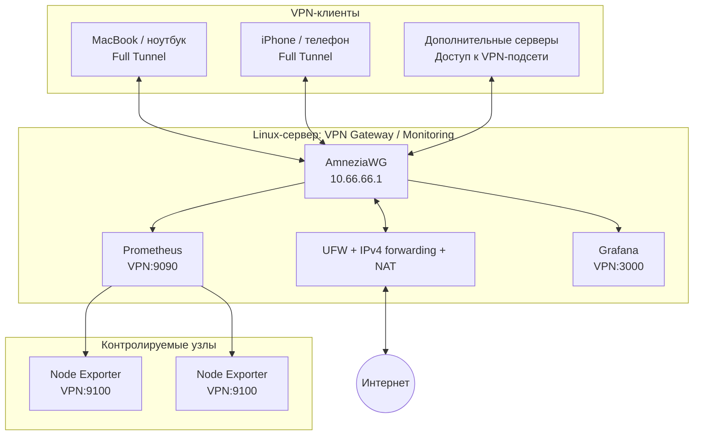

# Server Infrastructure Automation: Bootstrap, Security & Monitoring

Ansible + Terraform проект для автоматизации создания и настройки Linux-сервера, который работает веб-сервер и как закрытая точка мониторинга на базе **Prometheus и Grafana**.

> Проект был проверен на Ubuntu Server 24.04 LTS. Конкретные версии Ansible Collections и Docker-образов следует фиксировать после проверки на целевой системе.

## Задачи проекта
- Создать сервер, используя IAC инструмент terraform
- Автоматизировать первоначальную настройку Linux-сервера с помощью Ansible.
- Защитить сервер
- Развернуть Prometheus и Grafana с помощью Docker Compose.
- Устанавливать Node Exporter на сервер с помощью готовой роли Ansible Galaxy.
- Хранить приватные данные в Ansible Vault и применять изменения повторяемо.

## Архитектура



### Как работает VPN

Для личных устройств используется Full Tunnel: клиент направляет IPv4-трафик через VPN-шлюз. Сервер выполняет маршрутизацию и NAT, поэтому внешний интернет-трафик выходит с публичного адреса VPS.

Для дополнительных серверов используется отдельный профиль: через VPN маршрутизируется только внутренняя подсеть, необходимая для администрирования и мониторинга. Их обычный исходящий интернет-трафик не обязан идти через VPN-шлюз.

`AllowedIPs` имеют разное назначение на разных сторонах соединения:

- На личном клиенте `0.0.0.0/0` задаёт Full Tunnel для IPv4.
- На клиенте-сервере указывается VPN-подсеть, например `10.66.66.0/24`.
- В конфигурации VPN-шлюза для каждого peer указывается только его адрес `/32`, например `10.66.66.11/32`.

### Как работает мониторинг

Prometheus и Grafana запускаются в Docker Compose. В текущем варианте они используют сетевой режим хоста и слушают VPN-адрес сервера, а не публичный интерфейс. Это позволяет обращаться к панелям только после подключения к VPN и не публиковать их через Docker `ports`.

Node Exporter устанавливается непосредственно на контролируемые Linux-хосты через роль `prometheus.prometheus.node_exporter`. Экспортер привязывается к VPN-адресу узла, а firewall разрешает доступ к порту `9100` только с адреса Prometheus-сервера. Поскольку адрес появляется вместе с интерфейсом `awg0`, systemd-служба Node Exporter должна запускаться после VPN-интерфейса. Аналогичную зависимость нужно учесть для Compose-службы Prometheus и Grafana, если их процессы привязываются к VPN-IP при старте.

## Технологии

| Область | Инструменты |
|---|---|
| Infrastructure as Code | Ansible, Ansible Roles, Ansible Vault |
| Операционная система | Ubuntu Server 24.04 LTS |
| VPN | AmneziaWG |
| Сетевая безопасность | UFW, sysctl, IPv4 forwarding, NAT |
| Контейнеризация | Docker Engine, Docker Compose v2 |
| Мониторинг | Prometheus, Grafana, Node Exporter |
| Ansible Collections | `community.general`, `community.docker`, `prometheus.prometheus` |

## Структура проекта

Пример логического разделения файлов и компонентов репозитория:

```text
.
├── ansible.cfg
├── requirements.yml
├── inventory/
│   ├── hosts.example.yml
│   └── group_vars/
│       ├── all.yml
│       └── vault.yml             # зашифрованный Ansible Vault
├── playbooks/
│   └── site.yml
├── roles/
│   ├── common/                   # базовая настройка ОС и SSH
│   ├── docker/                   # Docker Engine и Compose plugin
│   ├── amneziawg/                # VPN, маршрутизация и NAT
│   └── monitoring/               # Prometheus + Grafana через Compose
└── README.md
```

Node Exporter не дублируется собственной ролью: для его установки используется готовая роль `prometheus.prometheus.node_exporter` из Ansible Galaxy.

### Назначение ролей

| Роль | Ответственность |
|---|---|
| `common` | Обновление системы, базовые пакеты, SSH, UFW, Fail2ban и общие настройки безопасности. |
| `docker` | Установка Docker Engine и Compose plugin, настройка Docker daemon. |
| `amneziawg` | Установка AmneziaWG, генерация конфигурации интерфейса, включение IPv4 forwarding, NAT и firewall-правил. |
| `monitoring` | Развёртывание Prometheus и Grafana через Docker Compose, конфигурация Prometheus и provisioning Grafana. |
| `prometheus.prometheus.node_exporter` | Установка и управление Node Exporter на контролируемых узлах. |

## Безопасность

Безопасность здесь строится не только на наличии VPN, но и на ограничении сетевой доступности сервисов.

- **Административный доступ через VPN.** SSH и веб-интерфейсы мониторинга должны быть доступны через VPN-адреса. Публичный доступ к портам `3000`, `9090` и `9100` не требуется.
- **Минимально необходимые firewall-правила.** Разрешается входящее VPN-соединение по UDP и только те внутренние соединения, которые нужны для администрирования и сбора метрик.
- **Разделение VPN-профилей.** Личные устройства используют Full Tunnel, серверные peers получают доступ только к VPN-подсети. Не следует разрешать бесконтрольную маршрутизацию между всеми peers.
- **Защита секретов.** Приватный ключ сервера и пароль Grafana хранятся в Ansible Vault. Приватные ключи клиентских устройств остаются на самих устройствах; на сервере достаточно хранить их публичные ключи.
- **Права на конфигурацию.** Файл конфигурации AmneziaWG должен принадлежать `root` и иметь права `0600`. Задачи Ansible, обрабатывающие приватные ключи и пароли, должны использовать `no_log: true`.
- **Контейнеры.** Для Prometheus и Grafana следует использовать фиксированные версии образов, непривилегированных пользователей там, где это поддерживается, `no-new-privileges`, минимальный набор capabilities и постоянные volumes для данных.
- **Docker и UFW.** Docker управляет собственными firewall-правилами и может влиять на цепочку `FORWARD`; UFW не следует считать универсальной защитой опубликованных Docker-портов. В этой схеме для Prometheus и Grafana не используются опубликованные Docker-порты, а доступ ограничивается привязкой к VPN-IP и правилами хоста. После настройки нужно проверить `iptables -S FORWARD` и фактическую работу маршрутизации.
- **NAT.** Правило `MASQUERADE` должно использовать реальный внешний интерфейс сервера. При добавлении правила в `/etc/ufw/before.rules` нужно сохранить одну таблицу `*nat` и добавить правило внутрь неё, а не создавать дублирующий блок таблицы.
- **Осторожное применение firewall.** Не закрывайте текущий SSH-доступ до проверки VPN-подключения и наличия консоли управления у провайдера. Изменения UFW и маршрутизации нужно применять последовательно и проверять после каждого этапа.

### Ограничения и допущения

1. **IPv4 и IPv6.** Описанная схема Full Tunnel относится к IPv4. Пока полноценная маршрутизация IPv6 через VPN не настроена, IPv6-трафик на клиентском устройстве может идти вне туннеля. Необходимо либо отдельно настроить IPv6 через VPN, либо надёжно отключить/блокировать IPv6 для соответствующего подключения на клиенте. Одного `net.ipv6.conf.all.forwarding=0` на сервере для защиты от утечки недостаточно.
2. **Обход блокировок.** AmneziaWG использует механизмы маскировки VPN-трафика, но не гарантирует доступность соединения при любых блокировках, DPI-политиках или блокировке IP-адреса сервера.
3. **Host networking.** `network_mode: host` упрощает привязку Prometheus и Grafana к VPN-IP, но контейнеры используют сетевой namespace хоста. Изоляция сети между контейнерами и хостом в этом режиме ограничена; безопасность обеспечивается корректной привязкой адресов, firewall и настройками контейнеров.
4. **Ресурсы.** Для небольшого VPS необходимо контролировать потребление памяти и диска. Retention Prometheus и размер хранилища должны соответствовать доступному объёму диска; в качестве начальной настройки можно использовать ограниченное хранение метрик, например 7 дней и лимит около 2 GB, а затем скорректировать его по фактической нагрузке.

## Подготовка

### Требования

- Контроллер с установленным Ansible.
- Целевые серверы на Ubuntu Server 24.04 LTS.
- SSH-доступ с правами `sudo`.
- SSH-ключ для подключения Ansible.
- Открытый UDP-порт VPN на уровне firewall сервера и панели провайдера.
- Доступ к консоли провайдера на случай ошибки в настройке SSH или firewall.
- Kernel headers для текущего ядра, необходимые при установке модуля AmneziaWG на Ubuntu.

### Установка Ansible Collections

В `requirements.yml` должны быть перечислены используемые коллекции:

```yaml
---
collections:
  - name: community.general
  - name: community.docker
  - name: prometheus.prometheus
```

Установить их можно командой:

```bash
ansible-galaxy collection install -r requirements.yml
```

Для воспроизводимого развёртывания рекомендуется зафиксировать проверенные версии коллекций в `requirements.yml` после тестирования проекта.

### Настройка inventory и переменных

1. Скопируйте пример inventory в локальный файл, например `inventory/hosts.yml`.
2. Укажите адреса серверов, SSH-пользователя и группы хостов.
3. Заполните общие переменные в `inventory/group_vars/all.yml`: VPN-подсеть, адрес VPN-шлюза, внешний сетевой интерфейс, SSH-порт, адреса peers и параметры мониторинга.
4. Создайте зашифрованный файл секретов:

```bash
ansible-vault create inventory/group_vars/vault.yml
```

5. Поместите в Vault приватный ключ VPN-шлюза, пароль Grafana и другие секреты. Не храните пароль Ansible Vault в репозитории.

Приватные ключи клиентских устройств не нужно переносить на сервер или в репозиторий. Для настройки peer на сервере используются публичный ключ и выделенный VPN-адрес клиента.

## Запуск

Сначала проверьте, что Ansible видит inventory и может подключиться к узлам:

```bash
ansible-inventory -i inventory/hosts.yml --graph
ansible -i inventory/hosts.yml all -m ping
```

Проверьте синтаксис playbook:

```bash
ansible-playbook -i inventory/hosts.yml playbooks/site.yml --syntax-check
```

Перед первым применением изучите изменения и, где это поддерживается задачами, выполните check mode:

```bash
ansible-playbook -i inventory/hosts.yml playbooks/site.yml --check --ask-vault-pass
```

После проверки примените конфигурацию:

```bash
ansible-playbook -i inventory/hosts.yml playbooks/site.yml --ask-vault-pass
```

Не запускайте первый полный deployment на единственном удалённом сервере без резервного доступа через консоль провайдера. Особенно внимательно проверьте задачи, изменяющие SSH, UFW, NAT и маршрутизацию.

## Проверка после развёртывания

Проверки стоит выполнять как с самого сервера, так и с VPN-клиента.

### VPN-шлюз

```bash
sudo systemctl status awg-quick@awg0
sudo awg show
sysctl net.ipv4.ip_forward
ip route get 1.1.1.1
sudo iptables -t nat -S
sudo ufw status verbose
```

Ожидаемый результат: интерфейс AmneziaWG поднят, IPv4 forwarding включён, для VPN-подсети настроен NAT через фактический внешний интерфейс, а firewall разрешает только необходимые соединения.

### Мониторинг

```bash
docker compose ps
ss -lnt
```

Проверьте, что Prometheus и Grafana слушают VPN-адрес, а не `0.0.0.0` или публичный IP. В Prometheus проверьте состояние targets: Node Exporter должен иметь статус `UP`.

Примеры внутренних адресов при использовании тестовой подсети:

- Grafana: `http://10.66.66.1:3000`
- Prometheus: `http://10.66.66.1:9090`
- Node Exporter: `http://<VPN-IP-узла>:9100/metrics`

Проверьте, что эти интерфейсы доступны после подключения к VPN и недоступны с внешней сети. Также проверьте Full Tunnel: внешний IPv4-адрес личного устройства должен совпадать с публичным адресом VPN-сервера.

## Полезные ссылки

- [Документация AmneziaWG](https://docs.amnezia.org/documentation/amnezia-wg/)
- [Установка модуля AmneziaWG на Linux](https://docs.amnezia.org/documentation/instructions/install-amneziawg-kernel-module-linux/)
- [Prometheus Community Ansible Collection](https://github.com/prometheus-community/ansible)
- [Роль Node Exporter](https://prometheus-community.github.io/ansible/node_exporter_role.html)
- [Документация community.docker.docker_compose_v2](https://docs.ansible.com/projects/ansible/latest/collections/community/docker/docker_compose_v2_module.html)
- [Документация Prometheus](https://prometheus.io/docs/)
- [Документация Grafana](https://grafana.com/docs/)

## Что демонстрирует проект

Проект показывает практический подход к автоматизации инфраструктуры: разделение конфигурации на роли, использование готовых Ansible Collections там, где это оправдано, управление секретами через Vault, настройку VPN-маршрутизации и firewall, а также развёртывание мониторинга в контейнерах.

Главный акцент — не на количестве установленных инструментов, а на том, чтобы после повторного запуска Ansible сервер приходил к ожидаемому состоянию, а административные интерфейсы оставались доступны только через доверенную VPN-сеть.
